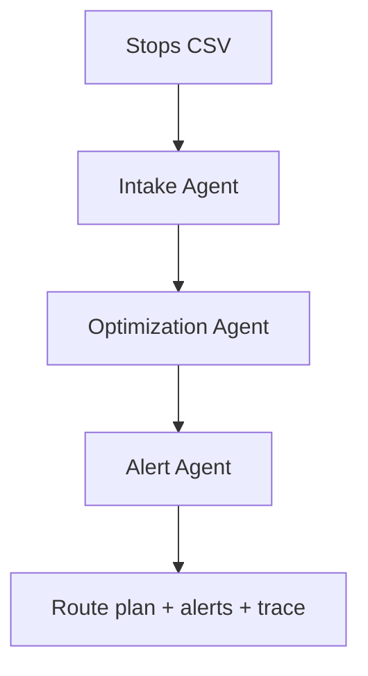

# Transportation Route Optimizer Agent

An agentic transportation-planning project that converts delivery stops into an optimized route, explains the plan, and raises operational alerts. It also tracks when the optimization policy was last reviewed and warns when the configurable semiannual review is due.

## Agents

| Agent | Responsibility |
| --- | --- |
| Intake Agent | Validates stop IDs, coordinates, service time, and priority. |
| Optimization Agent | Builds a distance-efficient route with priority-aware nearest-neighbor planning. |
| Alert Agent | Flags long route legs and overdue optimization-policy reviews. |
| Coordinator | Runs the agents in order and returns a traceable JSON result. |



## Features

- Runs without an API key or external routing service
- Uses geographic distance and stop priority
- Returns ordered stops, leg distances, total distance, and alerts
- Configurable long-leg threshold
- Configurable optimization review interval, defaulting to 182 days
- Structured interaction trace for each agent
- Synthetic sample data and unit tests

## Run

```bash
python -m src.workflow --stops data/stops.csv --config config.json
python -m unittest discover -s tests -v
```

The output is JSON, which makes the project easy to connect to a dashboard, dispatch system, email service, or traffic API.

## Production extensions

- Replace Haversine distance with road-network travel times from a routing API.
- Add vehicle capacities, driver hours, time windows, and depot constraints with OR-Tools.
- Feed weather, traffic, and road-closure events into the Alert Agent.
- Send alerts through email, Slack, SMS, or a transportation-management system.
- Store optimization runs so performance can be compared before and after each semiannual review.

## Data note

The included locations and shipments are synthetic demonstration data.

## License

MIT
